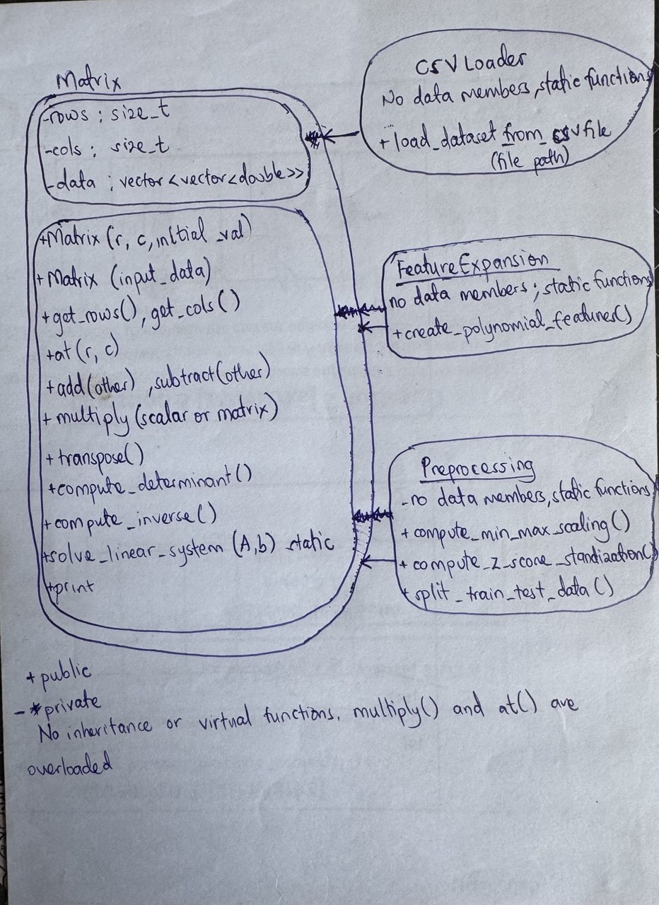

# Individual Progress Report - Week 03
Name: KYANKYA JOSEPH
Role / Module:** Kyankya Joseph - Unit Test Suites

# 1. Summary of Completed Deliverables
A. test_regression.cpp (integration tests for polynomial regression)
This file tests whether the regression code finds the correct weights for data where the answer is already known.
functions
1. Degree 1 linear fit: it fits a model to four points on the line y = 2x + 1 and checks that the intercept is 1 and the slope is 2 by using assert.
2. Degree 2 quadratic fit: it fits a model to five points on the curve y = x^2 + 2x + 3, predicts the same points, and checks that the mean squared error is about 0.
3. Helper and main: the helper function is_nearly_equal allows a small tolerance when comparing decimals. The main function runs both tests, catches any exception and returns 1 if something fails.

# 2. Object-Oriented Class Breakdown

What class did you create?
Answer: I did not create a class. I submitted test functions that use the group's classes: Matrix, PolynomialRegression and RegressionMetrics in the PolyReg namespace.

Why?
Answer: My role is testing. These tests check that the regression code gives the correct weights for data where the answer is known in advance.

What data does it hold?
Answer: The test file holds no data of its own except small matrices created inside each test. The Matrix class holds three private data members: rows, cols and data, a vector of vectors of doubles.

What functions operate on that data?
Answer: The tests call fit(), get_coefficients() and predict() on a PolynomialRegression object, compute_mean_squared_error() from RegressionMetrics, and get_rows() and at() on Matrix.

Why are some members private and others public? How is the class used by the rest of the program?
Answer: In Matrix, the data members rows, cols and data are private, so outside code cannot change the matrix size or the stored numbers directly. Public functions such as get_rows(), get_cols() and at() give controlled access, and at() checks that the index is inside the matrix. My tests can only call public functions.

Inheritance and polymorphism
Answer: No class in the code on main extends another and nothing is virtual, so there is no inheritance and no runtime polymorphism. Matrix does use function overloading but it has two constructors, two versions of at() and two versions of multiply().

Encapsulation
Answer: Matrix keeps its data private and exposes it only through public functions. CSVLoader, FeatureExpansion and Preprocessing hold no data and contain only static functions.

Class layout drawing (hand-drawn):

# 3. Challenges & Solutions
Challenge: The test calls PolynomialRegression and RegressionMetrics, which are not on main yet, so I could not compile it.
Solution: I said this clearly in the pull request description, and I will compile it once those classes are merged. 
Challenge: My project folder still had old .exe files from earlier builds, which could have been committed by mistake.
Solution: I added only the specific test file with git add and checked git status before committing.

# 4. AI Tool Transparency
Tool Used: Claude AI was consulted on syntax for the code. It was also used to further understand the task and also consulted on how to include an image in an MD file.